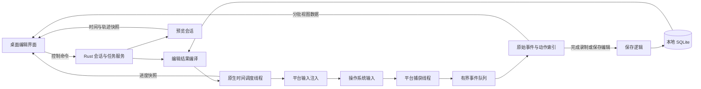

# ADR-0001：桌面键鼠录制与回放的技术方案及选型

日期：2026-10-25。

状态：**Tauri + Rust 方向已获用户确认；先 Windows、再 Linux X11，Wayland 单独验证，首版手动参考图及按键录放与文本编辑分开的范围也已确认。本文的前端框架、平台后端、存储和性能指标为建议方案，尚未实施或完成原生验证。**

依据：[功能需求](../requirements.md)。界面基线：[HTML 原型](../index.html)。本次工作仅整理文档，不包含原生功能实现；平台文档中的可用接口也不等于产品已经验证的支持能力。

实施任务、依赖与交付门槛见[实施计划](../implementation-plan.md)；本文保留技术选择的理由和实现约束。

2026-10-25 范围审查补充：以下架构是职责与候选路线，不要求首轮把所有模块、优化和恢复能力一次建齐。先以 Windows 当前环境完成可停止的真实录放，再尽早接入一条编辑、保存和执行路径。分块存储、持久化历史、完整模拟后端、专门范围索引等只在具体需求或测量证据成立时引入；不得因此删减已确认的功能验收。

## 1. 选型结论

建议使用 **Tauri 2 + Rust 原生引擎 + TypeScript 桌面编辑界面**。Rust 负责系统输入、事件数据、调度与持久化；WebView 负责交互和绘制。实时输入不能依赖网页事件、组件刷新或前端定时器。

| 层次 | 建议选择 | 主要理由与状态 |
| --- | --- | --- |
| 桌面壳 | Tauri 2 | 延续已确认方向，承载桌面窗口与 Rust 命令；框架具备能力不代表输入后端已经完成 |
| 界面 | TypeScript + React + Vite | 建议用于任务、编辑窗口和共享视图状态；React 是本次建议，可在开发前调整，不是原型已经采用的框架 |
| 时间线 | 先沿用原型交互与简单绘制；密度产生瓶颈时评估 Canvas 2D | 避免每个移动采样成为 DOM 节点；Canvas 与专门命中索引不是最小编辑试用的前置条件 |
| 输入引擎 | Rust，平台后端隔离 | 直接控制事件顺序、线程、计时与错误处理，不由界面逐事件指挥 |
| Windows 首轮后端 | `windows` crate 调用 Win32 低级钩子 + `SendInput`；有问题时做 Raw Input 对照 | 先验证一个捕获路径的完整性、计时和稳定性，不同时建设两套正式后端 |
| Linux X11 首轮后端 | `x11rb`，RECORD 捕获、XTEST 注入；XKB 处理键盘布局 | 建议验证路径，先检查服务端扩展和会话权限；不等于支持 Wayland |
| Linux Wayland | 独立验证项，能力检测与受控接口适配 | 尚不能承诺与 X11 同等的全局连续录制体验，见第 4 节 |
| 本地存储 | SQLite + `rusqlite`，先保存原始事件与当前编辑结果；分块/编码优化按需引入 | 保留事务与格式版本，捕获回调不写库；不默认建立历史版本或中断恢复系统 |
| 前后端通信 | Tauri commands 管控制；按需使用少量快照，流式传输再采用 Channel | 原始输入不逐条经过 IPC；原生回放不等待前端确认 |

Tauri 的 Core 与 WebView 有明确职责边界，Windows 和 Linux 使用的 WebView 实现也不同，仍需分别验证界面。[Tauri 进程模型](https://v2.tauri.app/concept/process-model/)。前端采用静态资源构建，不为桌面工具引入 SSR 或常驻 Node 服务。[Tauri 前端配置](https://v2.tauri.app/start/frontend/)、[Vite 文档](https://vite.dev/guide/)。

## 2. 本次考虑的替代方案

以下是本次选型分析，不是虚构的历史决策，也不是已完成的性能比较。

| 方案 | 适用性 | 本次取舍 |
| --- | --- | --- |
| Tauri + Rust | 现有 HTML 交互可逐步迁移，输入引擎可保持原生边界 | 建议采用；付出平台适配和 WebView 差异验证成本 |
| Electron + 原生输入模块 | 能承载同类编辑界面，仍需解决操作系统输入后端 | 没有消除本项目最难的输入/调度问题，且偏离已确认方向；不因语言不同就宣称它更慢 |
| Qt 或其他原生 UI | 可构建桌面编辑器，也可调用原生输入接口 | 可行，但需要重建界面与工程组织，目前没有足以切换路线的已知约束 |
| 仅浏览器/前端 DOM 事件 | 足够实现局部练习和交互原型 | 不满足 FR-02 的系统级录制与真实注入要求 |
| `rdev` / `enigo` 直接包办 | 可作为可替换适配器或验证工具 | 不把跨平台库名称当成完整支持矩阵或计时保证；不让依赖内置等待控制回放节奏 |

`rdev` 的常规 `listen` 文档明确依赖 X11，不能用该路径承诺 Wayland；其 `unstable_grab` 是另一条涉及设备权限的路径，也不直接解决桌面坐标问题。[rdev 官方 crate 文档](https://docs.rs/rdev/latest/rdev/)。`enigo` 主要提供输入模拟接口，应按实际后端和目标环境验证，而不是作为录制、编辑、调度的完整方案。[enigo 文档](https://docs.rs/enigo/latest/enigo/)。

## 3. 架构与关键边界



### 3.1 职责

- **前端**：任务区域、录制内容、时间线、编辑窗口与帮助；把坐标选点转换成录制坐标供 Rust 校验。使用一个会话时间源驱动预览、选择与时间线。
- **会话服务**：管理录制、预览、系统执行与停止状态。实际系统执行与录制互斥；预览不调用系统注入接口。
- **捕获后端**：只在用户明确开始后工作。保留收到的按下/抬起、移动、滚轮、顺序和时钟信息，不识别业务控件。
- **动作索引/编辑编译**：从原始事件构建可读动作；将编辑转成有效事件序列，验证键鼠状态和时间顺序。
- **调度后端**：在原生线程中等待截止时间并注入，界面卡顿不能成为动作调度的前置条件。
- **保存逻辑**：首先保证完整录制与编辑结果的事务保存；捕获回调不直接写库、压缩或等待 IPC。专用持续写入线程与恢复机制在规模或恢复需求明确后再引入。

### 3.2 IPC 与背压

控制使用具名命令，例如开始/停止录制、加载任务、提交编辑、预览与运行；这些是拟定接口，不是现存 API。按操作校验任务 ID、当前修订号或会话 ID，拒绝过期编辑或错误会话的请求；修订号可以是递增计数，不意味着持久化所有编辑历史。

首轮可在加载任务时读取一次所需数据并缓存，进度推送小型快照，不每帧查库。规模超出预算后再增加分批加载、时间范围查询或流式传输；界面更新频率不限制底层录制频率。Tauri 官方说明普通事件系统不面向低延迟或高吞吐数据，Channel 面向有序流式数据；输入热路径因此留在 Rust，需要流式视图数据时再使用 Channel。[Tauri Channel 文档](https://v2.tauri.app/develop/calling-frontend/#channels)。

视图快照可以合并；原始输入不能悄悄丢弃。队列耗尽时应标记录制不完整并停止/报告，不继续生成一份看似成功的录制。原始事件指的是后端收到的系统事件，不承诺还原每一条鼠标硬件报告。

## 4. 平台输入后端

### 4.1 Windows

首轮建议使用 Microsoft 的 [`windows` crate](https://github.com/microsoft/windows-rs) 调用 Win32，验证以下链路：

1. 专用线程安装 `WH_KEYBOARD_LL`、`WH_MOUSE_LL` 并维持消息循环。
2. 回调仅复制必要字段、读取时间戳、入队，随后继续钩子链；不通过钩子阻止正常用户输入。
3. 后台整理按键、鼠标绝对位置、滚轮值和来源标记；回放使用 `SendInput`。

低级钩子存在超时后被移除的风险；Microsoft 也建议在许多场景考虑 Raw Input。首轮先验证选定的钩子路径；若出现事件缺失、钩子失效、吞吐不足或无法解释的计时偏差，再用 Raw Input 做对应条件的对照验证。未做对照不能宣称钩子是最快方案，但不要求为首个可用版本同时实现两套后端。这里优先验证钩子，是因为桌面位置与终点编辑是 FR-04 的直接需求；Raw Input 的设备数据还需处理坐标、加速和设备映射。[键盘钩子说明](https://learn.microsoft.com/en-us/windows/win32/winmsg/lowlevelkeyboardproc)、[鼠标钩子说明](https://learn.microsoft.com/en-us/windows/win32/winmsg/lowlevelmouseproc)、[Raw Input](https://learn.microsoft.com/en-us/windows/win32/inputdev/raw-input)。

`SendInput` 会受 UIPI 完整性级别限制；返回成功插入的数量也不等于目标软件已经完成处理。须检查实际返回数量，部分失败不能自动重放整批输入，避免重复点击。受限或提升权限的应用应报告不支持/权限不足；不以让整个程序始终管理员运行作为默认解决方式。[SendInput](https://learn.microsoft.com/en-us/windows/win32/api/winuser/nf-winuser-sendinput)。

本工具注入可通过来源标记辅助过滤；再用录制/执行互斥防止录回自己的输入。不能只看“事件是注入的”就认定它一定来自本工具。

### 4.2 Linux X11

建议以 `x11rb` 封装服务端协议：RECORD 获取会话输入，XTEST 注入。启动时检查对应扩展、连接授权、键盘映射和桌面几何；缺少能力时报告原因，不静默换成仅窗口内录制。[x11rb RECORD 接口](https://docs.rs/x11rb/latest/x11rb/protocol/record/index.html)、[XTEST 协议](https://xorg.freedesktop.org/archive/X11R7.7/doc/xextproto/xtest.html)。

捕获和控制连接分开设计，避免阻塞读取拖住控制命令。键盘布局与修饰键需要 XKB 状态；不能把 Windows 扫描码直接发送给 X11。原样回放先以同一会话、布局和桌面几何为验证条件，跨机器迁移另列兼容问题。

XWayland 中能使用部分 X11 接口，也不能据此声称已经覆盖原生 Wayland 应用或整个 Wayland 会话。

### 4.3 Linux Wayland

这是能力验证项，不是已经解决的平台适配。

- RemoteDesktop portal 的 `ConnectToEIS` 可以建立输入发送连接；仍需由桌面后端支持、授权并提供相应能力。[RemoteDesktop 接口](https://flatpak.github.io/xdg-desktop-portal/docs/doc-org.freedesktop.portal.RemoteDesktop.html)。
- InputCapture portal 有启用、激活、停用和指针屏障等会话语义。`Enable` 不意味着立即开始持续捕获；不能把它直接当成“正常操作桌面时始终旁听全部输入”的通用接口。[InputCapture 接口](https://flatpak.github.io/xdg-desktop-portal/docs/doc-org.freedesktop.portal.InputCapture.html)。
- `evdev` 设备读取与 `uinput` 虚拟设备是另一条候选路线，会引入设备权限、座席隔离、坐标及合成器行为问题。内核文档提供的是虚拟设备能力，不是免授权、跨桌面一致的宏录制方案。[Linux uinput](https://docs.kernel.org/input/uinput.html)。

**用户已确认先完成 Windows，再交付 Linux X11；Wayland 单独验证，不作为这两个阶段的交付前置条件。** Wayland 验证应选定 GNOME/KDE 等具体后端和版本，明确权限方式，证明全局录制、绝对终点编辑和回放同时成立，再给出支持承诺。Linux X11 仍是明确的后续交付目标，不能以 Windows 完成替代 Linux 交付。

## 5. 事件模型、归并与编辑

### 5.1 三层数据

| 层次 | 建议内容 | 约束 |
| --- | --- | --- |
| 原始录制 | 事件序号、相对单调时间、来源/后端、原生键码、按下/抬起、坐标、滚轮值及单位 | 作为可追溯原始数据保留；同时间戳用序号排序 |
| 动作视图 | 稳定动作 ID、原始事件引用/序号范围、类型、起止时间、终点或展示值 | 只是索引与归并，不能替代底层按下/抬起；引用允许跨轨道交错 |
| 编辑计划 | 插入等待、终点修改、耗时修改、点击方式和输入内容修改 | 形成修订后的执行计划；不把修改结果伪称原始记录 |

时间建议使用相对录制起点的整数微秒；保留后端原生时间用于诊断。墙上时间仅用于任务日期，不能驱动回放。前端只接收所需的相对时间与视图数据，避免大整数被 JavaScript 转换后损失精度。

### 5.2 归并规则

- 鼠标连续移动归并为一段动作，全部收到的轨迹留在原始层。归并边界依据时间、按键状态和其他动作，阈值通过实测确定。
- 双击依据平台配置和真实事件序列识别。原始回放保留两次按下/抬起及间隔；编辑为双击时也必须编译成两组事件。
- 滚轮同方向连续输入可汇总为一个展示动作，但保留原始输入和方向变化。不能把方向相反的输入相加抵消后丢失动作。
- 组合键和文本展示不抹掉修饰键或按键抬起。按住鼠标移动时也不能把按键状态当作普通移动而丢掉。
- 不生成“姓名框”“提交”等数据中不存在的目标名称。

### 5.3 编辑语义

终点编辑根据原始路径生成派生路径：固定起点，逐渐调整到新终点，保留整体走向；这是建议算法，需要用预览验证。紧接着的点击仅在明确联动时调整。原始路径始终可追溯。

插入等待修改执行时间映射。例如原型示例总长 6800 ms，在输入动作结束的 2150 ms 处插入 1000 ms：原来 2550 ms 的 Tab 变为 3550 ms，总长变为 7800 ms，原有 400 ms 间隔仍保留。此处数值是说明性示例，不是原生性能测试。

提交编辑时验证时间非负、事件有序、按下/抬起关系、坐标范围和有效输入。若编辑造成按键状态不成立，应拒绝或明确修复方案，不悄悄补充业务动作。

### 5.4 键盘文本和输入法

用户已确认首版原样回放以实际键盘事件为基础，新增或编辑文本单独处理；可读文本只在能确定时提供，不要求自动识别输入法最终提交的中文。Windows 的 `ToUnicodeEx` 接收虚拟键、键盘状态和布局，不能据其存在推导出“已经获得任意应用的输入法提交结果”。这是本方案对接口边界的判断。[ToUnicodeEx](https://learn.microsoft.com/en-us/windows/win32/api/winuser/nf-winuser-tounicodeex)。

需要分别验证：英文/符号、Shift/CapsLock、布局切换、死键、长按重复、中文拼音输入与候选选择。不能把拼音按键展示成已提交的中文文本。

用户编辑“输入文本”后，将其标记为明确的文本输入动作，选择并验证相应字符注入路径；与录制的物理按键回放分开。自动粘贴会改动剪贴板，因此不作为未经说明的默认字符输入策略。

### 5.5 滚轮与坐标

滚轮保留来源、轴、原生增量和单位；界面统一显示方向与正的数量。浏览器原型的 `deltaY` 与 Windows 原生滚轮符号约定不能直接互用。Windows 定义了滚轮方向和 `WHEEL_DELTA = 120`，适配器应明确转换，不能把所有滚轮量都标为像素。[MOUSEINPUT](https://learn.microsoft.com/en-us/windows/win32/api/winuser/ns-winuser-mouseinput)。

坐标记录应附带桌面原点、显示器布局、缩放与坐标空间。Windows 后端须统一 DPI 上下文并验证虚拟桌面负坐标、绝对输入和多屏映射；前端 CSS 坐标不能直接送入原生注入。X11 以会话桌面坐标建模。显示布局变化时先阻止不可靠执行并说明原因，不默默按比例猜测新目标。

## 6. 低延迟与原生调度

### 6.1 调度原则

以单调时钟记录时间并计算截止时间。Windows 优先验证 QPC；Linux 使用单调时钟与绝对截止等待。QPC 不随系统墙上时间校准倒退，但计时分辨率不能保证线程一定按时获得 CPU。[Microsoft 高分辨率时间戳说明](https://learn.microsoft.com/en-us/windows/win32/sysinfo/acquiring-high-resolution-time-stamps)。

```text
计划截止时间 = 本次回放单调起点 + 编辑后的相对事件时间 / 回放速度
```

- 每次等待都重新对准绝对截止时间，不能“睡眠间隔 → 执行耗时 → 再睡下一个间隔”而累积漂移。
- 在专用原生线程验证可取消的等待。Windows 可评估 waitable timer，Linux 评估绝对时间等待；可用模式、系统版本和误差必须实测。
- 不依赖 JavaScript `setTimeout`、`requestAnimationFrame` 或普通异步任务轮询触发系统输入；它们只承担界面刷新。
- 不能为每个动作无条件增加固定延时。若需要兼容某类目标应用的额外等待，应成为明确选项或编辑动作。
- 不默认整段忙等。短时间精细等待只有在测量证明有必要时引入，并记录 CPU 代价。
- 停止信号直接进入原生控制路径，等待时可以被唤醒；不能依赖前端下一帧才响应。

### 6.2 建议的性能验证指标

下表是**待验证和确认的工程目标，不是用户已给出的数字，也不是已取得的结果**。

| 指标 | 首轮目标/测量方式 |
| --- | --- |
| 计划注入偏差 | 在约定的本地空载测试机上，注入调用相对计划截止时间的绝对偏差 P95 ≤ 5 ms、P99 ≤ 15 ms；同时公布最大值和负载条件 |
| 三分钟累计漂移 | 使用末次与首次调度误差之差衡量，建议绝对值 ≤ 20 ms；不把目标软件绘制耗时算成引擎已控制的结果 |
| 原始事件完整性 | 用已知事件序列核对按下/抬起、序号、滚轮方向；丢失和溢出为零，否则明确判为未通过 |
| 停止响应 | 从原生停止信号到停止新注入，建议 P95 ≤ 50 ms；另外检查本引擎持有的按键释放情况 |
| 界面流畅性 | 在约定事件规模下检查拖动、缩放与编辑延迟；界面压力不能改变调度事件序列 |

分开测量：捕获回调到入队、入队到保存、计划到注入调用、目标应用接收/响应、前端绘制。保存时间不是输入发生时间，目标应用响应也不能用引擎调用成功替代。

用已知序列、相同单调时钟日志及接收端记录交叉核对。优先复用能记录按下/抬起、顺序与时间的测试页或窗口，缺少时只补最小接收器；不要求建设完整独立测试平台，也不能只看目标最终文字或画面就认为事件正确。先记录当前环境的三分钟基线，后续按声明支持范围补长时、密集移动和 UI 阻塞。记录 OS/会话、CPU、显示器/DPI、目标程序、负载与规模；时间戳不能假装测到硬件触发时刻，跨平台性能不从一台机器外推。

普通桌面操作系统不是硬实时环境；严重超时应记录并按明确策略停止/报告，不能在恢复后无提示地瞬间补发大量过期点击。补发策略和容忍阈值需在验证后确定。

## 7. 持久化、可靠性与权限

### 7.1 本地数据

SQLite + `rusqlite` 仍是默认建议，首轮保存任务、原始事件、当前编辑结果和格式版本。动作索引可重建，修订号可作为当前值保存，不要求将每次编辑历史都持久化。原始事件先使用适合已验证规模的简单序列化；测量表明加载、保存或内存超过预算时，再考虑带时间/序号索引的分块 BLOB、Serde/CBOR 或压缩。优化须有具体瓶颈依据。[rusqlite](https://docs.rs/rusqlite/latest/rusqlite/)、[ciborium](https://docs.rs/ciborium/latest/ciborium/)。

捕获线程与数据库隔离。首轮可在录制结束后事务保存；内容与完成状态一并提交，失败不能破坏旧任务或假报成功。用户明确需要中断恢复，或实际录制规模需要持续落盘时，再增加后台分批提交与恢复状态；未保存的录制不承诺可在进程中断后找回。已经存在的未完成数据不能伪装成完整录制。

需要并发读写时才评估 WAL 及相应 checkpoint/备份策略，不为首轮任务保存预建这套机制。若采用 WAL，不能只复制主数据库文件就认为已正确备份活动数据。[SQLite WAL 官方说明](https://www.sqlite.org/wal.html)。

当前原型的 `localStorage` 仅支撑演示，不能作为系统录制的数据方案。正式导入导出、保留历史或崩溃恢复若进入范围，再明确对应格式、保留规则及允许丢失的时间窗口；不以这些待选能力阻塞基本任务保存。

### 7.2 状态和失败

建议状态：空闲、准备录制、录制中、预览中、系统执行中、停止中、失败。状态由 Rust 管理，所有界面共享同一会话快照。

- 无权限、后端不可用、注入数量不足、队列溢出、显示布局变化时，返回可理解的原因，不能悄悄切换语义或假报成功。
- 停止和失败时，仅对本次引擎注入并仍持有的键鼠状态做收尾；不能无差别抬起用户实际持有的所有按键。用户物理输入冲突也需要明确处理规则。
- 系统运行中发生挂起、会话切换或权限撤回时终止当前执行，不在恢复后突然补发剩余输入。
- 编辑确认更新当前编辑结果与修订号；取消不写入。新录制成功保存前保护旧内容；成功后是否继续保留旧版本，仍由功能需求的待确认事项决定，不默认实现历史版本管理。

正常停止与进程被强制结束需要分别测试。后者不能依赖原进程的清理逻辑保证释放输入；是否引入独立看护进程或其他恢复手段，需要技术验证，不能先承诺所有崩溃场景都能自动收尾。

### 7.3 应用权限与输入隐私

前端只暴露必要的具名命令，不开放任意脚本/系统命令执行。Tauri capabilities 限制插件访问，同时对自定义命令显式配置范围和后端状态校验；官方说明默认注册的应用命令并非自动按最小权限隔离，不能仅配置一个 capability 文件就声称已经安全。[Tauri capabilities](https://v2.tauri.app/security/capabilities/)。

建议录制仅由用户主动开启、状态清楚可见，原始文本保存在本地，不写入常规日志、不自动上传。全局输入接口不能保证知道密码框在哪，因此不能承诺自动识别并排除所有敏感字段。

录制开始/停止快捷键以及工具自身界面操作的排除规则需要明确设计；过滤自己的控制窗口不等于识别第三方软件中的业务控件。

## 8. 预览与时间线实现约定

- 共享一个会话时间、当前选择和录制修订号。UI 可以对进度快照插值绘制，但不反向把界面帧率当作系统输入时钟。
- 预览模式只画指针、点击和键盘反馈；系统运行模式才接入注入后端，入口需明确区分。
- 原始输入只能重建指针与键鼠反馈，不能重建其他软件的历史画面。首版已确认使用用户手动导入的参考图叠加指针，不含自动截图或同步屏幕录像；无图时保留轨迹及键鼠反馈。后续若增加截图/录像，另行设计采集、时间同步、权限及容量。
- 首轮可以加载并缓存当前任务所需数据、绘制可见部分，不每帧查库，也不为每个移动采样创建 DOM。有实际性能瓶颈时再增加范围查询、Canvas 或专门位置索引，不能把全部优化作为首次编辑试用的前置条件。
- 控制按钮和动作列表保留 DOM 与键盘操作；Canvas 不是以牺牲可访问性替代所有控件。
- 窗口隐藏/显示、缩放与适合窗口不修改原始时间；视图菜单中的“时间线”只切换面板可见性。所有最新交互以 FR-07 至 FR-11 为准。

## 9. 实施前验证顺序

本节是验证主题清单，不表示当前已经开始实现，也不要求所有环境验证完才接界面。当前 Windows 先完成核心路径，其他兼容与规模验证按实施计划逐步补齐。

| 验证项 | 必须得到的证据 | 关联需求 |
| --- | --- | --- |
| POC-01 Windows 原生链路 | 系统范围捕获、完整事件序列、三分钟原节奏回放及权限失败样例；选定后端出现问题时补 Raw Input 对照 | FR-02、FR-03 |
| POC-02 编辑与调度 | 终点修改和联动点击、插入一秒等待、双击和组合键顺序、停止后的按键收尾 | FR-03 至 FR-05 |
| POC-03 Linux 支持矩阵 | X11 扩展和实机回放结果；Wayland 捕获/注入/坐标/权限分别给出结论 | FR-02、FR-03 |
| POC-04 键盘与坐标边界 | 先验证当前布局、输入法和桌面；再按声明支持范围补死键、重复键、布局切换、DPI、多屏/负坐标和布局变化 | FR-02、FR-04、FR-06 |
| POC-05 桌面界面与数据量 | Windows WebView2/Linux WebKitGTK 中的时间线、共享预览、面板显隐与独立演示；确定最大事件规模和存储预算 | FR-01、FR-07 至 FR-11 |

所有版本、硬件条件和失败场景要进入验证记录。验收依据是 [AC-01 至 AC-14](../requirements.md)，性能数值先按第 6 节提案试验，再与用户确认最终门槛。依赖版本在开始工程化时锁定，本文不以 `latest` 文档地址代替依赖锁文件。

生产界面打包为本地静态资源，开发服务器不作为最终运行依赖。Windows 的 WebView2、Linux 的 WebKitGTK 及目标发行版依赖需要进入安装验证；安装包格式、签名和发布流程在确定平台版本范围后再落实，不从 HTML 原型推断安装包已经可用。

## 10. 后续仍需定稿的决定

1. Windows 的具体版本/架构、Linux X11 的发行版/桌面及验证设备；Wayland 单独选择验证环境。
2. 在按键录放与明确文本输入分开的前提下，支持哪些布局、输入法和文本注入目标。
3. 系统执行/预览入口、全局停止快捷键、人工介入与超时策略。
4. 最大录制规模、性能阈值、任务版本/导出和循环执行规则。

以上均在 [功能需求的待确认事项](../requirements.md)中保留，按实施计划对应阶段逐项定稿，不以本技术建议替用户作出产品取舍。
